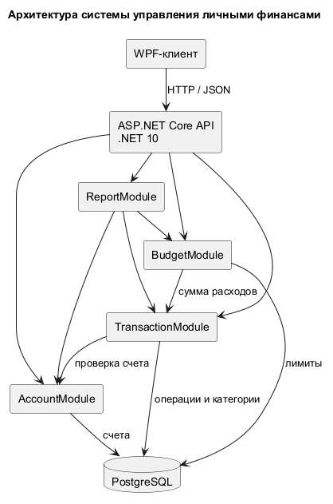
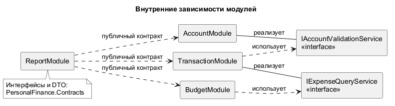
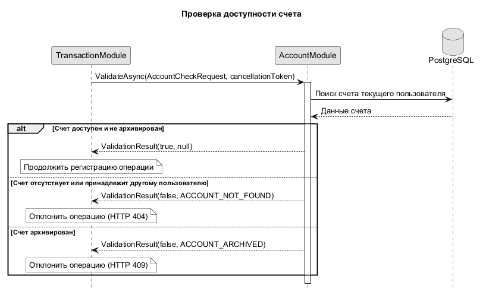
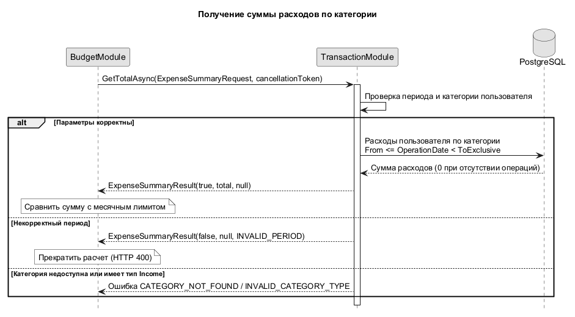
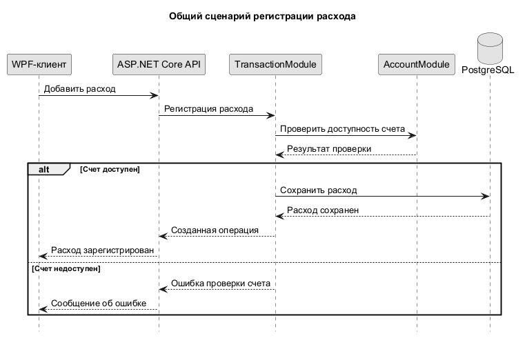

# Курсовое проектирование. Этап 1
## Разработка перечня артефактов и протоколов проекта

**Тема курсового проекта:** «Разработка системы управления личными финансами»

**МДК:** 02.02 «Инструментальные средства разработки программного обеспечения»  
**Стек:** C# / .NET 10, Git  
**Среда разработки:** Visual Studio  
**Тип приложения:** клиент-серверное приложение

---

# 1. Исходное состояние проекта

Перед началом выполнения этапа был создан Git-репозиторий курсового проекта.

Исходное состояние было проверено командой:

```bash
git status
```

Текущая ветка:

```text
main
```

Для выполнения этапа создана отдельная ветка:

```bash
git checkout -b docs/project-artifacts
```

В рамках данного этапа выполняется проектирование структуры программной системы и подготовка проектной документации.

---

# 2. Назначение и границы проекта

## 2.1. Назначение системы

Система предназначена для учета личных доходов и расходов, контроля состояния бюджета.

Пользователь должен иметь возможность:

- создавать и редактировать собственные финансовые счета;
- добавлять категории доходов и расходов;
- регистрировать доходы и расходы;
- просматривать остатки на счетах и историю операций;
- устанавливать месячный бюджет по категории расходов;
- просматривать отчеты за выбранный период.

## 2.2. Основные объекты предметной области

В системе выделены следующие основные сущности:

- пользователь;
- финансовый счет;
- категория;
- финансовая операция;
- месячный бюджет.

Примеры категорий расходов: 
- продукты;
- транспорт;
- развлечения.

## 2.3. Границы проекта

### В систему входит

1. Регистрация и авторизация пользователей.
2. Ведение собственных счетов и категорий.
3. Регистрация доходов и расходов с положительной суммой.
4. Расчет баланса по начальному остатку и операциям.
5. Установка месячных лимитов расходов по категориям.
6. Отчеты по доходам, расходам и выполнению бюджета.
7. Хранение истории операций и разграничение данных пользователей.

### В систему не входит

В рамках курсового проекта не реализуются:

- проведение банковских платежей;
- подключение банковских API и автоматический импорт выписок;
- валютная конвертация и переводы между счетами;
- инвестиционные рекомендации;
- мобильное приложение;
- автоматические SMS и электронные письма.

---

# 3. Реестр проектных артефактов

Для проекта сформирован следующий перечень артефактов. 

| № | Артефакт | Назначение | Расположение |
|---:|---|---|---|
| 1 | Описание назначения и границ проекта | Определяет функции и ограничения системы | `docs/project-scope.md` |
| 2 | Перечень модулей | Описывает состав системы и ответственность модулей | `docs/modules.md` |
| 3 | Архитектурная схема | Показывает структуру и связи модулей | `docs/architecture.md` |
| 4 | Перечень зависимостей | Фиксирует внутренние и внешние зависимости | `docs/dependencies.md` |
| 5 | Контракты взаимодействия | Определяет правила обмена между модулями | `docs/contracts.md` |
| 6 | DTO | Определяет структуры передаваемых данных | `docs/dto.md` |
| 7 | Инструкция сборки и запуска | Позволяет другому разработчику запустить проект | `README.md` |
| 8 | Тестовая стратегия | Определяет порядок проверки системы | `docs/testing.md` |
| 9 | Правила работы с Git | Определяет правила ветвления и коммитов | `docs/version-control.md` |
| 10 | Журнал технических решений | Фиксирует значимые архитектурные решения | `docs/decisions/` |

---

# 4. Перечень модулей системы

На сервере выделяются четыре функциональных модуля.

| Модуль | Ответственность |
|---|---|
| `AccountModule` | Ведение счетов и проверка их доступности пользователю |
| `TransactionModule` | Ведение категорий и регистрация доходов и расходов |
| `BudgetModule` | Месячные лимиты расходов и оценка их выполнения |
| `ReportModule` | Сводные отчеты и расчет остатков |

## 4.1. AccountModule

Отвечает за работу с финансовыми счетами пользователя.

Основные функции:

- создание счета и указание начального остатка;
- получение списка счетов и данных отдельного счета;
- изменение названия счета;
- проверка принадлежности счета текущему пользователю;
- архивирование счета.

Пример состояний счета:

```text
Active
Archived
```

Архивный счет сохраняется в истории, но не принимает новые операции.

---

## 4.2. TransactionModule

Отвечает за учет доходов, расходов и категорий финансовых операций.

Основные функции:

- создание и получение категорий доходов и расходов;
- проверка суммы, типа операции и выбранной категории;
- регистрация дохода или расхода;
- получение истории операций за выбранный период;
- расчет суммы расходов по категории.

Пример типов финансовой операции:

```text
Income
Expense
```

Перед регистрацией операции модуль взаимодействует с:

```text
AccountModule
```

---

## 4.3. BudgetModule

Отвечает за установку месячных лимитов расходов и контроль их выполнения.

Основные функции:

- установка и изменение лимита по категории на календарный месяц;
- получение установленного бюджета;
- получение суммы расходов по категории за месяц;
- расчет оставшейся суммы бюджета;
- определение превышения установленного лимита.

Пример расчетных состояний бюджета:

```text
WithinLimit
Exceeded
```

Состояние определяется сравнением суммы расходов с лимитом: при сумме расходов не больше лимита — `WithinLimit`, при превышении — `Exceeded`.

Модуль взаимодействует с:

```text
TransactionModule
```

---

## 4.4. ReportModule

Отвечает за формирование финансовых отчетов пользователя.

Основные функции:

- получение данных о счетах, операциях и бюджетах через публичные контракты модулей;
- расчет общей суммы доходов и расходов за выбранный период;
- расчет остатков по счетам;
- группировка расходов по категориям;
- формирование сводного отчета и сведений о выполнении бюджета.

Модуль взаимодействует с:

```text
AccountModule
TransactionModule
BudgetModule
```

Отчеты формируются по запросу и не изменяют исходные данные. Собственные состояния отчета в первоначальной версии не предусматриваются.

---

# 5. Архитектурная схема

Выбирается клиент-серверная архитектура с модульным сервером на ASP.NET Core.



При регистрации операции сервер проверяет права пользователя и доступность счета, сохраняет операцию и возвращает результат клиенту. Клиент не обращается к базе данных напрямую.

---

# 6. Предполагаемая структура решения

```text
personal-finance-managment-system/
├── src/
│   ├── PersonalFinance.Api/
│   ├── PersonalFinance.Wpf/
│   ├── PersonalFinance.Contracts/
│   ├── PersonalFinance.AccountModule/
│   ├── PersonalFinance.TransactionModule/
│   ├── PersonalFinance.BudgetModule/
│   ├── PersonalFinance.ReportModule/
│   └── PersonalFinance.Persistence/
├── tests/
│   ├── PersonalFinance.UnitTests/
│   └── PersonalFinance.IntegrationTests/
├── docs/
│   ├── project-scope.md
│   ├── modules.md
│   ├── architecture.md
│   ├── dependencies.md
│   ├── contracts.md
│   ├── dto.md
│   ├── testing.md
│   ├── version-control.md
│   └── decisions/
│       ├── ADR-001-client-server.md
│       └── ADR-002-module-contracts.md
├── .gitignore
├── README.md
├── stage-01.md
└── personal-finance-managment-system.slnx
```

---

# 7. Внутренние зависимости



Интерфейсы и DTO размещаются в `PersonalFinance.Contracts`. Модули не обращаются напрямую к внутренним классам и таблицам друг друга. Общая база данных не отменяет границ модулей.

---

# 8. Внешние зависимости

| Зависимость | Назначение |
|---|---|
| .NET 10 и C# | Платформа клиента, сервера и модулей |
| WPF | Пользовательский интерфейс Windows |
| ASP.NET Core | Серверный HTTP API |
| ASP.NET Core Identity | Учетные записи и проверка подлинности |
| Entity Framework Core | Доступ к данным |
| PostgreSQL | Хранение реляционных данных системы |
| OpenAPI и Swagger UI | Описание и проверка HTTP API |
| xUnit | Автоматические тесты |
| Visual Studio | Разработка и отладка |
| Git и GitHub | История изменений и удаленный репозиторий |
Конкретные версии библиотек фиксируются в конфигурационных файлах проектов.

---

# 9. Основные DTO проекта

DTO передаются между клиентом и сервером в JSON. Ниже приведены проектируемые модели C# и используемое ими перечисление.

## 9.1. TransactionType

Определяет тип финансовой операции: доход или расход.

```csharp
public enum TransactionType
{
    Income,
    Expense
}
```

---

## 9.2. AccountDto

Содержит идентификатор и название счета, начальный остаток и признак архивирования.

```csharp
public record AccountDto(
    Guid Id,
    string Name,
    decimal OpeningBalance,
    bool IsArchived
);
```

---

## 9.3. CreateTransactionRequest

```csharp
public record CreateTransactionRequest(
    Guid RequestId,
    Guid AccountId,
    Guid CategoryId,
    TransactionType Type,
    decimal Amount,
    DateOnly OperationDate,
    string? Comment
);
```

---

## 9.4. TransactionDto

```csharp
public record TransactionDto(
    Guid Id,
    Guid AccountId,
    Guid CategoryId,
    TransactionType Type,
    decimal Amount,
    DateOnly OperationDate,
    string? Comment
);
```

---

## 9.5. AccountCheckRequest

```csharp
public record AccountCheckRequest(
    Guid UserId,
    Guid AccountId
);
```

---

## 9.6. ValidationResult

```csharp
public record ValidationResult(
    bool IsValid,
    string? ErrorCode
);
```

---

## 9.7. ExpenseSummaryRequest

```csharp
public record ExpenseSummaryRequest(
    Guid UserId,
    Guid CategoryId,
    DateOnly From,
    DateOnly ToExclusive
);
```

---

## 9.8. ExpenseSummaryResult

```csharp
public record ExpenseSummaryResult(
    bool Success,
    decimal? Total,
    string? ErrorCode
);
```

---

# 10. Описание API

| Метод | Адрес | Назначение |
|---|---|---|
| `GET` | `/api/v1/accounts` | Получение собственных счетов |
| `POST` | `/api/v1/accounts` | Создание счета |
| `GET` | `/api/v1/categories` | Получение категорий |
| `POST` | `/api/v1/categories` | Создание категории |
| `POST` | `/api/v1/transactions` | Регистрация дохода или расхода |
| `GET` | `/api/v1/transactions` | История операций за период |
| `PUT` | `/api/v1/budgets/{categoryId}/{year}/{month}` | Установка месячного лимита |
| `GET` | `/api/v1/budgets/{categoryId}/{year}/{month}` | Проверка выполнения бюджета |
| `GET` | `/api/v1/reports/summary` | Сводный отчет за период |

---

# 11. Протокол взаимодействия № 1
## Проверка доступности счета

### 11.1. Инициатор и получатель

**Инициатор:** `TransactionModule`. **Получатель:** `AccountModule`.

### 11.2. Назначение

Перед регистрацией дохода или расхода проверить, что счет принадлежит текущему пользователю и не находится в архиве.

### 11.3. Механизм вызова

Асинхронный вызов внутри процесса сервера через `IAccountValidationService`.
### 11.4. Точка входа

```csharp
Task<ValidationResult> ValidateAsync(
    AccountCheckRequest request, CancellationToken cancellationToken);
```
### 11.5. Формат запроса

```json
{
  "userId": "758d711c-292a-4bcc-b2fe-77425cfe0486",
  "accountId": "4f7fb20d-b92c-4082-a031-7eb643216a18"
}
```
### 11.6. Успешный ответ

```json
{ "isValid": true, "errorCode": null }
```
### 11.7. Ошибки

| Код | Описание |
|---|---|
| `ACCOUNT_NOT_FOUND` | Счет отсутствует или принадлежит другому пользователю |
| `ACCOUNT_ARCHIVED` | Счет находится в архиве |

```json
{ "isValid": false, "errorCode": "ACCOUNT_ARCHIVED" }
```
### 11.8. Таймаут

Операция должна завершиться не более чем за:

```text
2 секунды
```

---

### 11.9. Повторная отправка

Автоматический повтор внутренней операции не выполняется.

---

### 11.10. Аутентификация

Дополнительная аутентификация между модулями не требуется, поскольку они работают внутри одного процесса сервера.

Проверка пользователя выполняется на уровне ASP.NET Core API.

---

### 11.11. Версия контракта

```text
AccountValidationContract v1
```

---

### 11.12. Пример обмена



При успешной проверке `TransactionModule` сохраняет операцию.

При ошибке `ACCOUNT_ARCHIVED` операция отклоняется, и клиенту возвращается HTTP 409.

---

# 12. Протокол взаимодействия № 2
## Получение суммы расходов по категории

### 12.1. Инициатор и получатель

**Инициатор:** `BudgetModule`. **Получатель:** `TransactionModule`.

### 12.2. Назначение

Получить сумму расходов пользователя по категории за календарный месяц для сравнения с бюджетным лимитом.

### 12.3. Механизм вызова

Асинхронный вызов внутри процесса через `IExpenseQueryService`.

### 12.4. Точка входа

```csharp
Task<ExpenseSummaryResult> GetTotalAsync(
    ExpenseSummaryRequest request, CancellationToken cancellationToken);
```

### 12.5. Формат запроса

```json
{
  "userId": "758d711c-292a-4bcc-b2fe-77425cfe0486",
  "categoryId": "0597961c-c511-45db-a2cb-f197460dd21d",
  "from": "2026-11-01",
  "toExclusive": "2026-12-01"
}
```

### 12.6. Успешный ответ

```json
{ "success": true, "total": 12500.00, "errorCode": null }
```

При отсутствии операций сумма равна нулю. Учитываются только расходы владельца в указанном интервале.

### 12.7. Ошибки

| Код | Описание |
|---|---|
| `CATEGORY_NOT_FOUND` | Категория отсутствует или принадлежит другому пользователю |
| `INVALID_PERIOD` | Начало периода не меньше его исключаемого конца |
| `INVALID_CATEGORY_TYPE` | Категория предназначена для доходов |

```json
{ "success": false, "total": null, "errorCode": "INVALID_PERIOD" }
```

Ошибка не подменяется нулевой суммой. API возвращает HTTP 404 для отсутствующей категории и 400 для некорректных параметров.

### 12.8. Таймаут

Операция должна завершиться не более чем за:

```text
2 секунды
```

---

### 12.9. Повторная отправка

Автоматический повтор не выполняется. При необходимости пользователь повторяет запрос.

---

### 12.10. Аутентификация

Дополнительная аутентификация между модулями не требуется.

Проверка пользователя выполняется на уровне ASP.NET Core API. Выборка ограничивается данными пользователя.

---

### 12.11. Версия контракта

```text
ExpenseSummaryContract v1
```

---

### 12.12. Пример обмена



При успешном ответе `BudgetModule` сравнивает сумму расходов с месячным лимитом.

При ошибке `INVALID_PERIOD` расчет отклоняется, и клиенту возвращается HTTP 400.

---

# 13. Общий сценарий регистрации расхода



---

# 14. Инструкция сборки и запуска

## Требования

- .NET SDK 10;
- PostgreSQL;
- Git.

## Получение проекта

```bash
git clone <адрес-репозитория>
cd personal-finance-managment-system
```

## Сборка и тесты

```bash
dotnet restore
dotnet build
dotnet test
```

## Запуск серверной части

```bash
dotnet run --project src/PersonalFinance.Api
```

## Запуск клиента

```bash
dotnet run --project src/PersonalFinance.Wpf
```

---

# 15. Тестовая стратегия

## 15.1. Модульные тесты

| Сценарий | Ожидаемый результат |
|---|---|
| Собственный активный счет | Проверка успешна |
| Архивный счет | `ACCOUNT_ARCHIVED` |
| Чужой счет | `ACCOUNT_NOT_FOUND` |
| Нулевая или отрицательная сумма | Регистрация отклонена |
| Расходы отсутствуют | Сумма равна нулю |
| Операция на границе следующего месяца | Не включена в текущий месяц |
| Доход в периоде отчета расходов | Не увеличивает расходы |

## 15.2. Интеграционные тесты

Интеграционные тесты проверяют взаимодействие HTTP-маршрутов, модулей и базы данных.

### Сценарий 1. Успешная регистрация расхода

Ожидается:

- расход зарегистрирован на собственном активном счете;
- в базе появилась запись.

### Сценарий 2. Регистрация расхода на архивном счете

Ожидается:

- операция не создана;
- возвращен HTTP 409.

### Сценарий 3. Обращение к чужому счету

Ожидается:

- операция не создана;
- возвращен HTTP 404.

### Сценарий 4. Расчет месячного бюджета

Ожидается:

- учтены расходы пользователя по выбранной категории за месяц;
- сумма расходов и остаток лимита рассчитаны корректно.

### Сценарий 5. Повторная отправка операции

Ожидается:

- повторный запрос с тем же `RequestId` и данными возвращает ранее созданную операцию;
- в базе остается одна запись;
- при изменении данных с тем же `RequestId` возвращен HTTP 409.

---

## 15.3. Проверка сборки

После появления программных проектов выполняются `dotnet build` и `dotnet test`. 

---

# 16. Правила ведения репозитория

Для проекта используются следующие ветки:

| Ветка |
|---|
| `main` |
| `develop` |
| `feature/*` |
| `fix/*` |
| `docs/*` |
| `refactor/*` |

## main

Содержит стабильную версию проекта.

## develop

Используется для объединения результатов разработки.

## feature/*

Используется для разработки новых функций.

Примеры:

```text
feature/accounts
feature/transactions
feature/budgets
```

## fix/*

Используется для исправления дефектов.

Например:

```text
fix/account-validation
```

## docs/*

Используется для подготовки и изменения документации.

Например:

```text
docs/project-artifacts
```

## refactor/*

Используется для улучшения структуры кода без изменения его поведения.

Например:

```text
refactor/transaction-service
```

---

# 17. Правила коммитов

Один коммит содержит одно логически завершенное изменение.

```text
feat: новая функциональность
fix: исправление
docs: документация
test: тесты
refactor: изменение структуры кода
chore: техническое изменение
```

Примеры будущих сообщений:

```text
docs: describe personal finance project scope
docs: add account and expense contracts
feat: add transaction registration
test: add account validation tests
```

---

# 18. Журнал технических решений

Решения будут храниться в `docs/decisions/`. Ниже приведены первоначальные предложения.

## ADR-001. Использование клиент-серверной архитектуры

**Статус:** предложено.

**Проблема:** отделить интерфейс Windows от хранения данных и бизнес-логики.

**Решение:** WPF-клиент и сервер ASP.NET Core на C# / .NET 10.

**Причина:** единый язык, разработка в Visual Studio, возможность проверять сервер независимо от клиента.

**Последствия:** требуется поддерживать HTTP-контракты и обрабатывать недоступность сервера.

## ADR-002. Взаимодействие через контракты

**Статус:** предложено.

**Проблема:** прямой доступ к внутренним данным модулей затрудняет тестирование и изменение системы.

**Решение:** публичные интерфейсы и DTO в `PersonalFinance.Contracts`.

**Последствия:** зависимости модулей явны; при изменении контракта необходимо обновлять потребителей и тесты.

---

# 19. Проверка выполнения этапа

После подготовки документа была выполнена самопроверка.

| Требование | Результат |
|---|---|
| Описано назначение проекта | Выполнено |
| Определены границы проекта | Выполнено |
| Выделены модули | Выполнено |
| Описана ответственность модулей | Выполнено |
| Подготовлена архитектурная схема | Выполнено |
| Определены внутренние зависимости | Выполнено |
| Определены внешние зависимости | Выполнено |
| Описан API | Выполнено |
| Описаны модели DTO | Выполнено |
| Описаны минимум два протокола | Выполнено |
| Подготовлена инструкция запуска | Требует проверки после реализации |
| Подготовлена тестовая стратегия | Выполнено |
| Определены правила Git | Выполнено |
| Описаны технические решения | Выполнено в документе |
| Созданы отдельные файлы артефактов | Предстоит выполнить |
| Изменения зафиксированы в Git | Предстоит выполнить |

---

# 20. Изменения в репозитории

В рамках этапа подготовлен документ:

```text
stage-01.md
```

На его основе предстоит подготовить отдельные файлы:

```text
docs/project-scope.md
docs/modules.md
docs/architecture.md
docs/dependencies.md
docs/contracts.md
docs/dto.md
docs/testing.md
docs/version-control.md
docs/decisions/ADR-001-client-server.md
docs/decisions/ADR-002-module-contracts.md
README.md
```

В документе также описаны модели контрактов (DTO) для клиента и сервера.

---

# 21. Пример истории Git

В ходе выполнения этапа изменения разделялись на логические коммиты.

Пример сообщений:

```text
docs: describe project scope
docs: add modules and architecture
docs: describe module dependencies
docs: add account and expense protocols
docs: add testing strategy
docs: add version control rules
docs: add architecture decisions
```

После завершения этапа выполняется:

```bash
git status
```

Репозиторий не должен содержать незакоммиченных изменений. 

---

# 22. Что было получено в результате этапа

В результате подготовки документа:

1. определено назначение системы управления личными финансами;
2. установлены границы проекта;
3. описана клиент-серверная архитектура (WPF + ASP.NET Core);
4. сформирована архитектурная схема;
5. описаны внутренние и внешние зависимости;
6. определены основные DTO;
7. определены точки входа HTTP API;
8. разработан протокол проверки доступности счета;
9. разработан протокол получения суммы расходов по категории;
10. определена тестовая стратегия;
11. определены правила ведения Git-репозитория;
12. описаны первоначальные технические решения.

---

# 23. Оставшиеся риски

На данном этапе выявлены следующие риски.

### Риск 1. Повторная регистрация расхода

После потери ответа пользователь может повторить запрос и создать дубликат операции.

Необходимо использовать уникальный `RequestId` и проверить повторную отправку тестом.

### Риск 2. Изменение состояния счета

Счет может быть архивирован после проверки, но до сохранения операции.

Необходимо обеспечить согласованность проверки и записи средствами транзакций или контроля конкурентных изменений.

### Риск 3. Денежные суммы и границы периода

Ошибки округления и выбора дат могут исказить финансовый отчет.

Необходимо определить точность хранения сумм и проверить границы отчетного периода.

### Риск 4. Доступ к чужим данным

Пользователь может попытаться получить данные другого пользователя.

Необходимо определять владельца по авторизованной учетной записи и ограничивать выборки его данными.

---

# 24. Вывод

В рамках первого этапа курсового проектирования была подготовлена проектная основа системы управления личными финансами.

Определены назначение и границы системы, состав функциональных модулей, их ответственность и зависимости. Разработана архитектурная схема клиент-серверного приложения, определены основные DTO и точки входа REST API.

Описаны два протокола взаимодействия: проверка доступности счета и получение суммы расходов по категории. Также определены порядок сборки и запуска, тестовая стратегия, правила ведения Git-репозитория и первоначальные технические решения.

Подготовленный документ позволяет продолжить оформление отдельных артефактов и использовать описанные контракты при разработке сервера на ASP.NET Core и клиента на WPF. Для завершения этапа необходимо подготовить файлы из реестра и зафиксировать изменения в Git.
